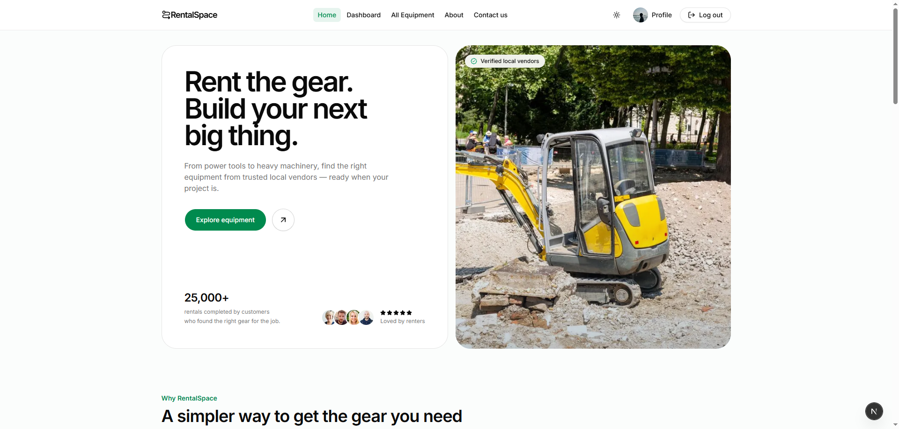
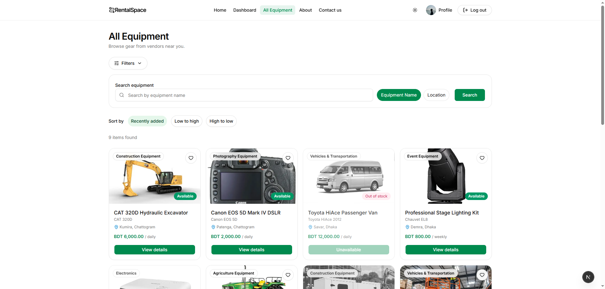
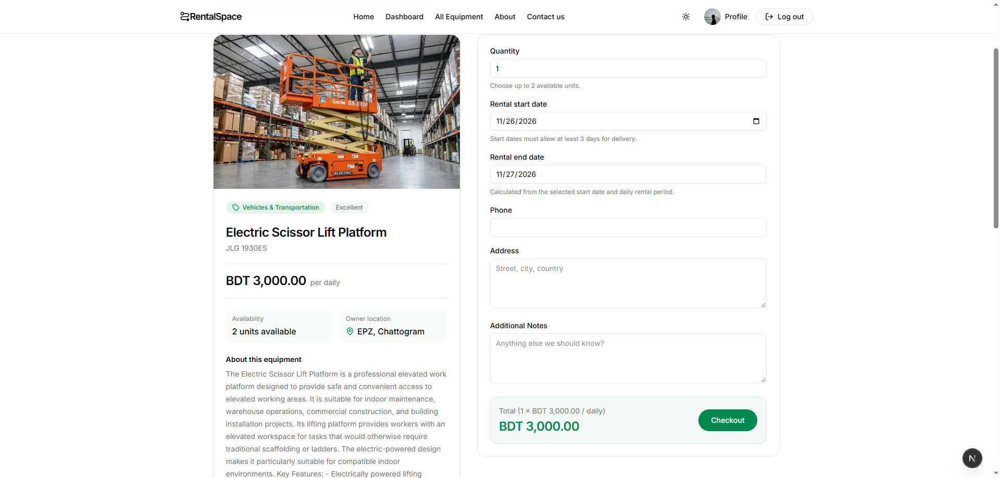
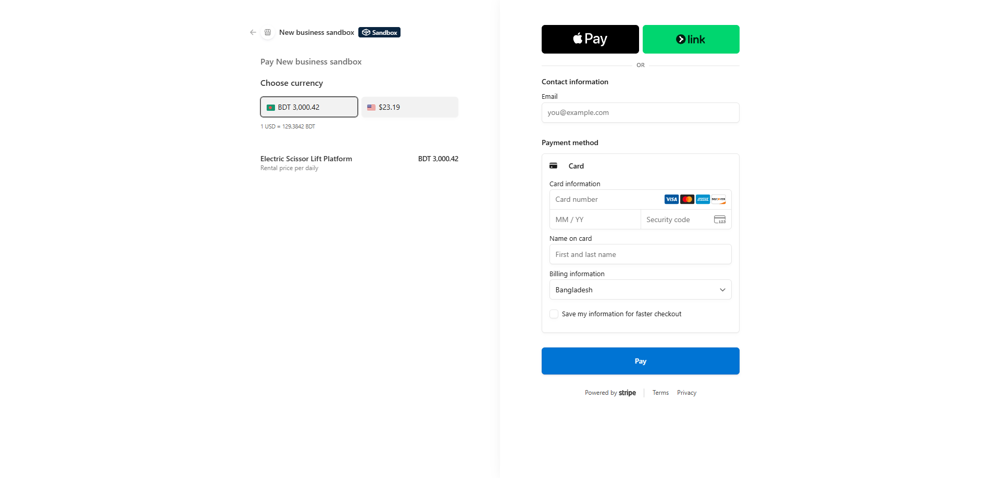

# RentalSpace

RentalSpace is an equipment-rental marketplace where customers can discover and rent equipment, owners can list and manage their gear, and administrators can review listings and oversee the marketplace.

## Screenshots

| Page | Preview |
| --- | --- |
| Home |  |
| Equipment catalog |  |
| Customer dashboard |  |
| Checkout |  |
| Payment |  |
| Owner dashboard |  |
| Owner analytics |  |
| Admin listing approval |  |
| Admin analytics |  |

## Website features

### Customer

- Browse equipment listings and filter the catalog.
- View equipment details and rental terms.
- Complete the checkout and payment flow.
- Manage rentals and favorites from the customer dashboard.
- Update profile information.

### Owner

- View an owner dashboard with rental and listing summaries.
- Add equipment listings and manage existing equipment.
- Track rentals and view analytics.

### Admin

- Review and approve equipment listings.
- Manage users and their marketplace roles.
- View all rentals and marketplace analytics.

## Tech stack
### Frontend 
- Next.js
- TypeScript
- Tailwind CSS 
- shadcn
- Framer Motion
- Better Auth (MongoDB Adapter)
- Stripe
- Recharts
- Lucide
- JWT

### Backend 
- Node.js
- Express.js
- MongoDB
- Stripe, Stripe Webhook
- Jose

## Links

- [Live Link](https://rentalspace-web.vercel.app/)
- [Github Client](https://github.com/rakibur-rafi/rentalspace-client)
- [Github Sever](https://github.com/rakibur-rafi/rentalspace-server)
